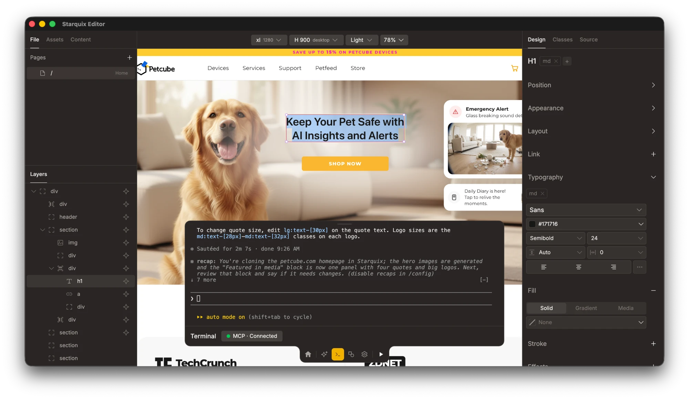
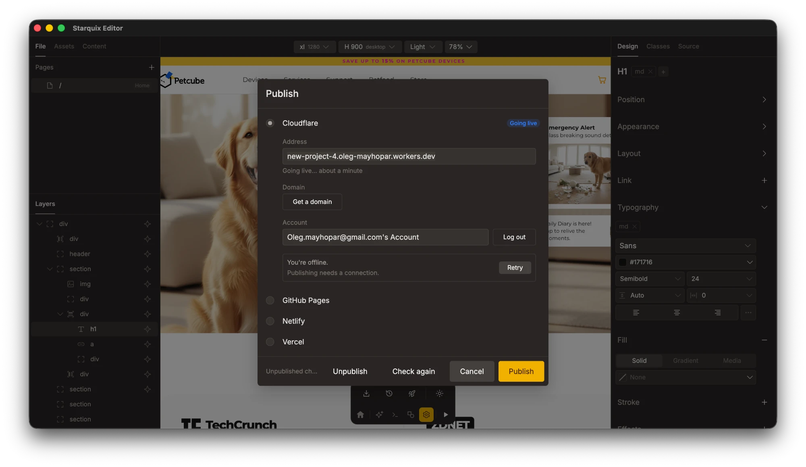

<h1 align="center">Starquix</h1>

<p align="center">
  A visual editor for <a href="https://astro.build">Astro</a> websites.<br>
  You design on a canvas. Every change is written as real code to a folder on your Mac.
</p>

<p align="center">
  
</p>

<p align="center">
  <a href="https://github.com/Mayhopar/Starquix-releases/releases/latest"></a>
</p>

<p align="center">
  <sub>macOS 13 or later · Apple Silicon · signed and notarized by Apple</sub><br>
  <sub><a href="https://mayhopar.com/blog/introducing-starquix/">Why it exists, with a demo video →</a></sub>
</p>

## Design it, keep the code

- **A canvas, not a form.** Pages, layers and a design panel, like in a design tool. Styling is Tailwind.
- **Real Astro files.** The site on the canvas is your Astro project. Open the same folder in your code editor at any time.
- **Agents welcome.** Run a coding agent in the built-in terminal, or use the AI chat with your own API key. Their edits show up on the canvas.
- **Blogs and SEO.** Content collections and SEO settings are built in.

## Publish from the app

<p align="center">
  
</p>

Cloudflare, GitHub Pages, Netlify or Vercel. Pick one, log in, press Publish.

## Install

1. Download `Starquix-<version>-arm64.dmg` from the [latest release](https://github.com/Mayhopar/Starquix-releases/releases/latest).
2. Open it and drag Starquix to Applications.

## Update

Starquix shows a link on the Projects screen when a newer version is out. Download the newer dmg and replace the app in Applications. Your projects live in `~/Starquix` and are not touched.

To hear about new versions on GitHub, click **Watch → Custom → Releases** at the top of this page.

<details>
<summary><b>Verify a download</b></summary>

<br>

```sh
shasum -a 256 Starquix-<version>-arm64.dmg
spctl -a -vv -t open --context context:primary-signature Starquix-<version>-arm64.dmg
```

The first line must match the SHA-256 in the release notes. The second must say `accepted`, `source=Notarized Developer ID` and `origin=Developer ID Application: Oleg Maykhopar (67L4BCPLP8)`.

</details>

## Bugs and ideas

[Open an issue](https://github.com/Mayhopar/Starquix-releases/issues/new/choose). For a security problem, [report it privately](https://github.com/Mayhopar/Starquix-releases/security/advisories/new) instead.

## About this repository

It holds the downloads and release notes, not the app's source code. The "Source code" archives that GitHub attaches to every release do not contain the app.
